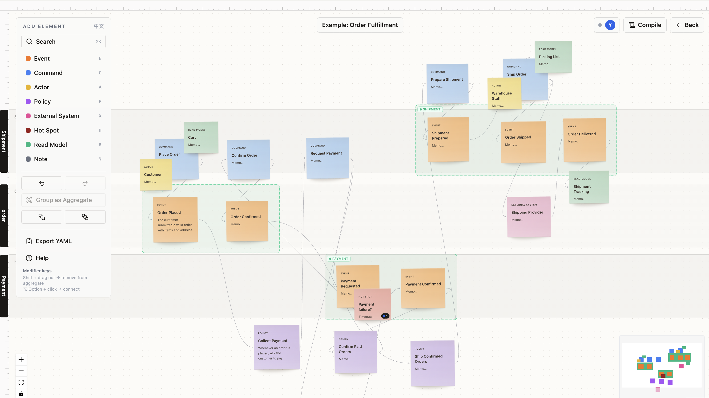

# Esbuddy

Esbuddy is a front-end app for visualising Event Storming workshops in Domain-Driven Design (DDD).



## Get started

Spin up the full stack (backend + SPA) locally, then open http://localhost:8787:

```bash
docker compose --env-file apps/server/.env.example up --build
```

## Elements

| Element | Color | Description |
|---|---|---|
| **Event** | orange `#f97316` | A significant thing that happened in the domain |
| **Command** | blue `#3b82f6` | An action that triggers an event |
| **Aggregate** | green `#10b981` | A boundary created by grouping Events/Commands; shown as a translucent box |
| **Actor** | yellow `#eab308` | A person or system that issues commands |
| **Policy** | purple `#a855f7` | Reactive logic triggered by an event ("when X, then Y") |
| **External System** | pink `#ec4899` | A dependency outside the system boundary |
| **Hot Spot** | red `#991b1b` | A conflict, question, or risk worth flagging |
| **Read Model** | green `#10b981` | The information an actor needs before making a decision |
| **Note** | gray `#6b7280` | A free-form note for comments — not part of Event Storming, ignored when compiling |

## Notes & Aggregates

- Each element is a square sticky note with a **title** and optional **memo** (double-click to edit), resizable via corner handles, with adjustable z-order.
- Select 2+ Events/Commands and click **Group as Aggregate** to draw a boundary box. It always covers its children (drag a child out to grow it, or hold `Shift` to remove it), moves them along with it, and accepts free Events/Commands dropped onto it.
- **Invariants**: a child never leaves its aggregate · aggregates can't nest · an element belongs to at most one aggregate · empty aggregates are removed.

## Keyboard Shortcuts

| Shortcut | Action |
|---|---|
| `E` `C` `A` `P` `X` `H` `R` `N` | Add an Event / Command / Actor / Policy / External System / Hot Spot / Read Model / Note at the cursor |
| `Shift` + drag out | Remove a child from its aggregate |
| `⌥ Option` / `Alt` + click | Connect the selected node(s) to the clicked node |
| `[` / `]` | Send to back / bring to front |
| `⌘`/`Ctrl` + `Z`, `⌘`/`Ctrl` + `⇧Z` (or `Ctrl`+`Y`) | Undo / Redo |
| `⌘`/`Ctrl` + click | Multi-select |
| double-click | Edit a note's title or memo |

One concern per modifier: **Shift** removes from an aggregate · **⌥/Alt** connects nodes · **⌘/Ctrl** multi-selects.

## Canvas

Infinite canvas with zoom, pan, and MiniMap. Pan with two-finger scroll, middle/right drag, or `Space` + drag; box-select by dragging empty canvas; connect by dragging a handle or `⌥`-clicking. Nodes, edges, and viewport auto-save and restore on refresh.

## Grammar & Compile to Text

Only relations Event Storming gives a meaning to are accepted, so a board can be compiled into plain English. A relation is written either by connecting notes or by sticking one note onto another — both mean the same.

| Connect | Meaning |
|---|---|
| Command → Event | produces |
| Event → Policy | triggers |
| Policy → Command, Actor → Command | issues |
| Event → Read Model | updates |
| Read Model → Command | supports (the data the decision is based on) |
| Command → External System | invokes |
| External System → Event | emits |

| Stick onto | Meaning |
|---|---|
| Actor on a Command | the actor issues it |
| Read Model on a Command | it supports that decision (an arrow *into* a read model is what updates it) |
| Hot Spot on any note (or bare aggregate space) | a question about it |

Sticking is a **binding**, like aggregate membership: drop an Actor / Read Model / Hot Spot onto exactly one note it can attach to (it lights up while dragging) and they are bound — moving the note moves what is stuck on it. Drag the stuck note off to unbind it (or onto another note to rebind). Dropped over several candidates, nothing is bound — the editor never guesses.

Any other edge can't be drawn. Overlaps are free while brainstorming, but **Compile** flags anything the grammar can't read without guessing (meaningless overlaps, overlaps that were never bound, unnamed notes, policies missing a trigger or a command…). Click a problem to jump to it; once there are no errors, copy or download the text as Markdown. Warnings (e.g. a command producing no event) never block compiling. Only Events and Commands can belong to an aggregate. Notes sit outside the grammar: they take no edges or bindings, may overlap anything, and are left out of the compiled text.

## Import / Export

**Export YAML** (toolbar) downloads the raw board — every node and edge as stored (id, type, position, size, label, memo, aggregate membership, bindings) — as `<canvas name>.yaml`, for backups, diffs and tooling. Unlike **Compile**, it doesn't check the grammar.

Export the canvas as Context Mapper (CML) — copy to clipboard or download `.cml`; import a `.cml` to render it. Supported: `Aggregate`, `Command`, `DomainEvent`, and `Flow` relations.

## Contributing

Building, testing, and deploying are documented in [AGENTS.md](./AGENTS.md).

## Roadmap

- [ ] Dark mode
- [ ] Right-click context menu to create elements
- [ ] Fuller CML support (Actor, Policy, External System mappings)
- [x] Real-time multi-user collaboration (Yjs CRDT; live cursors, selections and presence in both backend modes)

## More on DDD

- [Aggregates: An In-depth Examination — DDD Europe](https://youtu.be/m7SMk8VA7Bg?si=O1PNsNpHIHV0LPVE)
- [A step by step guide to Event Storming](https://www.boldare.com/blog/event-storming-guide/)
- [Event Storming — The Storm That Cleans Up The Mess!](https://medium.com/@samar.benamar/event-storming-the-storm-that-cleans-up-the-mess-b2bb578db7c)
- [Context Mapper](https://contextmapper.org/)
